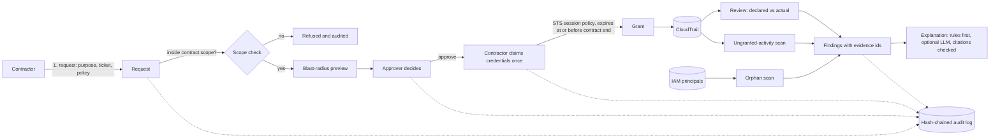

# Plumbline

**Engineering guardrails for small teams, with the evidence to back them.**

This first release is the contractor-access module. Small companies give contractors and vendors cloud access, then forget to remove it. Plumbline ties every grant to a contract, expires it automatically, shows the approver what the access can reach, and later checks what the contractor actually did against what they asked for. Every finding links to the exact event behind it.

> **Status: early (v0.1).** The core logic is tested (116 tests, CI on Python 3.11 to 3.13). It has **not** been run against a real AWS account or a live LLM, and the evaluation uses **simulated** data. See [What is and isn't tested](#what-is-and-isnt-tested) and [Not built yet](#not-built-yet) before relying on it.

## How it works



### What each part does

| Feature | What it does |
|---|---|
| Contract binding | A grant never outlives its contract. Ending a contract revokes its grants and cancels open requests. |
| Scope ceiling | Each contract carries the most a contractor may ever request. Requests outside it are refused and audited. A requested `s3:*` is **not** inside a ceiling of `s3:Get*`. |
| Purpose and ticket | A request must state what the access is for and cite a ticket. |
| Separation of duties | You cannot approve your own request. |
| Blast-radius preview | Plain-language summary and risk level (low to critical), shown to the approver before they decide. |
| Time-limited sessions | Credentials come from STS with a session policy limited to what was approved. They are returned once and never stored. |
| Revocation | Per-contract IAM role, with a Deny-older-sessions policy. See limitations. |
| Orphan scan | Finds contractor principals with no contract, an unknown contract, an ended contract, or no use for 90 days. |
| Declared vs actual | Flags refused calls outside scope, sensitive calls that were allowed, and unused permissions, with a tighter suggested policy. |
| Ungranted-activity scan | Flags activity on a contract role that no grant covers (credentials used outside Plumbline, or after expiry or revocation). |
| Evidence-checked explanations | Findings cannot exist without stored evidence. An optional LLM explanation is rejected unless it cites evidence that belongs to that finding. |
| Audit trail | Hash-chained log of every request, decision, grant, revoke and scan. |

## Try it with no AWS account (demo mode)

```bash
pip install -r requirements.txt
export PLUMBLINE_DEMO=1
export PLUMBLINE_KEYS='ka=alice@acme.example:contractor;kb=bob@corp.example:approver;kz=admin@corp.example:admin'
uvicorn plumbline.main:app
```

Open http://127.0.0.1:8000, sign in with `kb` to approve a request and `ka` to claim credentials. Demo mode uses an in-memory fake of AWS, so the credentials are fake and nothing real is touched.

## Before you point this at AWS

1. Create **one IAM role per contract**, named `contractor-<something>`, tagged `plumbline-contractor=true` and `plumbline-contract-id=<contract id>`. The trust policy lets Plumbline's role assume it (`examples/contract-role-trust.json`). Give the role at least the permissions of the contract's ceiling: the effective access is the *intersection* of the role's permissions and the session policy.
2. Give Plumbline a runtime identity with only the permissions in `examples/iam-plumbline-runtime.json`.
3. Set real API keys in `PLUMBLINE_KEYS` and put the service behind your single sign-on or a reverse proxy. The built-in API keys are a simple stand-in, not a substitute for SSO. Do not expose this to the internet as is.
4. Use a persistent database (`PLUMBLINE_DB=/path/plumbline.db`) and **save the audit head hash somewhere outside the system** (see limitations).
5. Try it in a test account first. The IAM examples have been written carefully but not validated against a live account.

Optional LLM explanations: set `ANTHROPIC_API_KEY` (and optionally `PLUMBLINE_MODEL`). Without it, deterministic template explanations are used.

## What is and isn't tested

| Area | How it is tested |
|---|---|
| Policy engine, access flow, analysis, evidence rules, audit chain, API roles | Unit and integration tests (116) |
| Real `Boto3Gateway` | Against [moto](https://github.com/getmoto/moto) for STS and IAM, and a botocore Stubber for CloudTrail (including pagination) |
| LLM explainer | Against a **mock** HTTP transport only. Never called against the live API in this repo's tests |
| Key rules | Mutation-checked once by hand: breaking the scope check, the contract-end cap, or separation of duties makes tests fail |
| Detection quality | Simulated scenarios only (see below) |
| Real AWS | **Not tested.** No live account was used |

### Evaluation (simulated data)

`python -m eval.run_eval --seed 7 --per-scenario 12` runs 192 simulated scenarios and writes [eval/RESULTS.md](eval/RESULTS.md).

| Measure | Result |
|---|---|
| False alarms on benign scenarios | 0.0% |
| Designed-for scenarios handled as expected | 100.0% |
| Known-hard harmful scenarios that raised any alert | 0.0% |

**How to read this honestly:** the scenarios were written by the people who wrote the rules, so the 100% shows the code does what it was designed to do and guards against regressions. It says nothing about how well Plumbline would do against real attackers. The known-hard cases (slow data theft within allowed access, reads unrelated to the stated purpose, one session used from two IP addresses) are caught by **none** of the current rules, and the results say so.

## Limitations to know about

- **Revocation ends every earlier session on the contract's role,** not one person's. That is how AWS allows it (a Deny keyed on `aws:TokenIssueTime`), and it is why each contract needs its own role.
- **Temporary credentials cannot be revoked individually and expire on their own.** Plumbline's expiry records follow the real credential expiry.
- **STS sessions last at least 15 minutes,** and an inline session policy is limited to 2,048 characters. Requests that don't fit are refused.
- **CloudTrail `LookupEvents`** covers management events from the last 90 days only, is rate limited, and events can arrive several minutes late. Run reviews some time after a session ends. Data events (for example S3 object reads) are only visible if you have enabled them in CloudTrail.
- **The audit log is tamper-evident, not tamper-proof.** Someone who can rewrite the whole database can rebuild a valid chain, and removing the newest entries is only caught if you saved an earlier head hash elsewhere.
- **Policies:** only `Allow` statements without `Condition`, `NotAction`, `NotResource` or `Principal` are accepted, because Plumbline does not evaluate those and will not pretend to. Scope checks use wildcard matching and fail closed.
- **IAM-user contractors** are found by the orphan scan, but activity from long-lived keys is not matched to grants.
- **The stated purpose is free text.** The rules cannot judge it. The optional LLM explanation is asked to compare purpose and activity, and its answer is only trusted if its citations check out.

## Not built yet

- Anomaly detection per contractor (feature M1.8). The evaluation shows the gap it is meant to fill.
- SOC 2 control mapping and PDF reports.
- The other modules (change-risk scorer, SLO kit).
- Azure and GCP.

## Development

```bash
pip install -r requirements-dev.txt
python -m pytest -q
python -m eval.run_eval --seed 7 --per-scenario 12
```

## License

MIT. See `LICENSE`.
